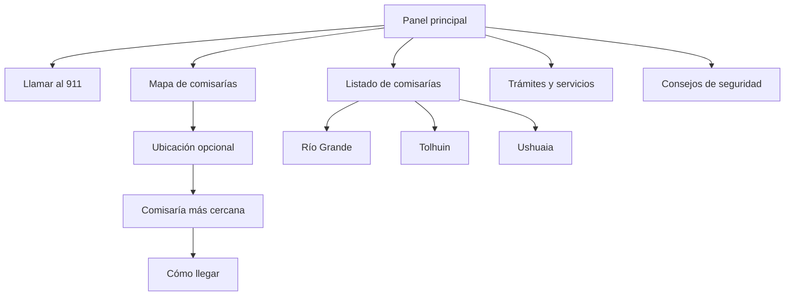

# Seguridad y Emergencias · Policía de Tierra del Fuego

<p align="center">
  
</p>

<p align="center">
  Panel web de acceso rápido a emergencias, comisarías, información útil y recomendaciones de prevención de la Policía de Tierra del Fuego, Antártida e Islas del Atlántico Sur.
</p>

<p align="center">
  <a href="#inicio-rápido">Inicio rápido</a> ·
  <a href="#uso-del-sitio">Uso</a> ·
  <a href="#para-quienes-mantienen-el-proyecto">Mantenimiento</a>
</p>

> **Ante una situación de riesgo inmediato, llamá al [911](tel:911).** Este sitio facilita el acceso a información y contactos; no reemplaza la comunicación con los servicios de emergencia.

## En un vistazo

| Necesito… | Acceso en el sitio |
| --- | --- |
| Comunicar una emergencia de seguridad | Botón principal **911**, disponible las 24 horas |
| Encontrar una dependencia cercana | [Mapa de comisarías](mapa.html) con geolocalización opcional |
| Consultar teléfonos y contactos | [Listado de comisarías](comisarias/comisarias.html), organizado por zona |
| Realizar una gestión | Acceso a trámites y servicios institucionales |
| Leer recomendaciones de prevención | [Consejos de seguridad](consejos.html) |

## Uso del sitio

El panel está diseñado con prioridad móvil: los accesos esenciales quedan visibles y los botones de llamada abren el marcador telefónico del dispositivo.

1. Desde la portada, seleccioná **911** para llamar ante delitos, situaciones de riesgo o necesidad de auxilio inmediato.
2. Elegí **Comisaría más cercana** para abrir el mapa. Si habilitás la ubicación, el sitio calcula la dependencia más próxima y ofrece una ruta en Google Maps.
3. Elegí **Listado de comisarías** para navegar por Río Grande, Tolhuin o Ushuaia y consultar los medios de contacto de cada dependencia.
4. Consultá **Trámites y servicios** o **Consejos de seguridad** según tu necesidad.
5. Podés cambiar el idioma entre español, inglés y portugués. La preferencia se conserva en el navegador.

### Recorrido de navegación



## Funcionalidades

- Acceso directo mediante `tel:911` y otros teléfonos de emergencia disponibles en el panel.
- Mapa interactivo de comisarías con Leaflet y OpenStreetMap.
- Cálculo local de la dependencia más cercana a partir de la ubicación que el usuario autorice compartir.
- Enlaces de navegación hacia Google Maps.
- Directorio de dependencias policiales por zona, con información de contacto.
- Consejos preventivos para vacaciones, vehículos, gas, estafas, hogar, vía pública, compras, menores en internet y seguridad vial.
- Interfaz adaptable a pantallas móviles y de escritorio.
- Internacionalización en español, inglés y portugués.
- Instalación como aplicación web progresiva (PWA) cuando el navegador lo admite.
- Compartir mediante la API nativa del dispositivo, con alternativa visual en navegadores que no la ofrecen.

## Inicio rápido

Este proyecto es un sitio estático: no requiere instalación de paquetes ni proceso de compilación.

```powershell
git clone https://github.com/policiatierradelfuego/sos.git
Set-Location sos
python -m http.server 8080
```

Luego abrí [http://localhost:8080](http://localhost:8080) en el navegador.

También puede abrirse `index.html` directamente, pero se recomienda un servidor local para que funcionen correctamente la carga de datos, el *service worker* y la experiencia PWA.

## Estructura del proyecto

```text
.
├── index.html                    # Panel principal de emergencias
├── mapa.html                     # Mapa y búsqueda de dependencia cercana
├── consejos.html                 # Recomendaciones de prevención
├── informacion-util.html          # Accesos a información y servicios
├── comisarias/
│   ├── comisarias.html            # Selector de zonas
│   ├── comisarias_norte.html      # Río Grande
│   ├── comisarias_centro.html     # Tolhuin
│   ├── comisarias_sur.html        # Ushuaia
│   └── data/dependencias.json     # Fuente de datos de las dependencias
├── css/styles.css                 # Estilos compartidos y diseño responsive
├── js/
│   ├── i18n.js                   # Traducciones y selector de idioma
│   ├── i18n-consejos.js          # Traducciones específicas de consejos
│   ├── main.js                    # Comportamientos del panel principal
│   ├── mapa.js                    # Mapa, GPS y cálculo de distancias
│   └── pwa.js                     # Registro y experiencia de instalación PWA
├── images/                        # Escudo, íconos y fotografías
├── manifest.webmanifest           # Metadatos de la aplicación instalable
└── sw.js                          # Caché y soporte sin conexión
```

## Para quienes mantienen el proyecto

### Datos de las dependencias

El archivo [`comisarias/data/dependencias.json`](comisarias/data/dependencias.json) es la fuente utilizada por el mapa y las páginas de comisarías. Al actualizarlo, conservá el formato JSON válido y los campos que consume la interfaz:

```json
{
  "dependencia": "Comisaría Primera Ushuaia",
  "direccion": "...",
  "email": "...",
  "telefono": "...",
  "whatsapp": "...",
  "lat": -54.8036619,
  "lng": -68.3121493
}
```

Las coordenadas (`lat` y `lng`) son necesarias para que una dependencia aparezca en el mapa y pueda participar del cálculo de cercanía.

### Idiomas

Las cadenas comunes viven en [`js/i18n.js`](js/i18n.js). Los textos de artículos de consejos se complementan en [`js/i18n-consejos.js`](js/i18n-consejos.js). Cuando se agregue un texto visible, incorporalo en los tres idiomas y asociá la clave mediante `data-i18n` o `data-i18n-attr`.

### PWA y caché

[`sw.js`](sw.js) aplica una estrategia *network-first* con respaldo en caché para los recursos del mismo origen. Si se agregan recursos críticos para el inicio sin conexión, incluílos en `PRECACHE` y actualizá el valor de `CACHE` para que los navegadores reciban la nueva versión.

### Servicios externos

El proyecto utiliza recursos externos para:

- Leaflet y las teselas cartográficas de OpenStreetMap.
- Íconos de Material Symbols y fuentes de Google.
- Rutas hacia Google Maps.
- Google Analytics, cuando esté disponible.

El sitio puede mostrar información previamente almacenada sin conexión, pero el mapa base, las rutas y los recursos externos requieren conectividad.

## Verificación antes de publicar

- Abrí `index.html` desde un servidor local y verificá que el acceso a **911** tenga el número correcto.
- Recorré cada acceso rápido y comprobá que no haya enlaces rotos.
- Probá el mapa sin otorgar ubicación y con ubicación autorizada. No habilites ubicación en pruebas si no es necesario.
- Confirmá la visualización en móvil y escritorio.
- Cambiá entre ES, EN y PT y revisá títulos, botones y contenido dinámico.
- Validá que cada registro modificado en `dependencias.json` tenga coordenadas numéricas correctas.
- Revisá la instalación PWA y la actualización de caché después de cambios relevantes.

## Privacidad y seguridad

La ubicación se solicita únicamente desde la función de búsqueda de dependencia cercana y depende de la autorización otorgada por la persona usuaria en su navegador. No incluyas en el repositorio información sensible, credenciales, claves de servicios ni datos personales que no estén autorizados para su difusión pública.

## Contribuciones

Para proponer una mejora o corregir información:

1. Creá una rama con un nombre descriptivo.
2. Mantené los cambios acotados y verificá los recorridos afectados.
3. Actualizá las traducciones, datos y caché cuando corresponda.
4. Abrí una solicitud de incorporación con una descripción clara de qué cambió y cómo se verificó.

## Licencia y uso institucional

No se declara una licencia de reutilización en este repositorio. Antes de reutilizar código, imágenes, identidad visual o contenido institucional, consultá a la Policía de Tierra del Fuego, Antártida e Islas del Atlántico Sur.
